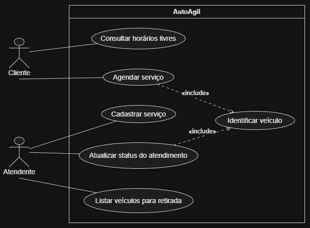

# 4.2.2 Modelagem de Casos de Uso

## Atores

Dois papéis operam o AutoAgil diretamente no dia a dia. O ator representa a função exercida no sistema, e não uma pessoa específica. 

Quem manipula a interface é o ator registrado, ainda que o cliente se beneficie da ação no final. Por exemplo: quando o Marcos confirma no balcão que o carro está pronto, quem opera o sistema é o Atendente.

| Ator | Quem é | O que faz no sistema |
|---|---|---|
| **Cliente** | Proprietário do veículo que necessita do serviço de lavagem | Consulta a grade de horários livres, realiza o agendamento do serviço e acompanha a situação da lavagem do seu carro. |
| **Atendente** | Responsável pela recepção e organização do pátio (Marcos ou funcionário do balcão) | Cadastra os tipos de serviço com prazos, confirma a chegada dos carros, atualiza as etapas da lavagem e sinaliza os veículos prontos. |

---

## Casos de uso

A lista abaixo representa os objetivos diretos que os atores realizam no sistema. Os nomes correspondem exatamente aos requisitos funcionais levantados na seção 4.2.1.

Requisitos como o cálculo do tempo estimado de entrega do veículo não geram uma elipse própria no diagrama, pois são etapas automáticas executadas durante o agendamento. Eles são detalhados como passos da especificação do fluxo principal.

| Caso de uso | Ator | Atende |
|---|---|---|
| **Cadastrar serviço** | Atendente | RF01 |
| **Consultar horários livres** | Cliente | RF02 |
| **Agendar serviço** | Cliente | RF03 e RF06 (o cálculo da previsão de entrega é executado no passo 5 do fluxo) |
| **Identificar veículo** | Nenhum (Caso de uso incluído) | Reuso compartilhado por Agendar serviço e Atualizar status do atendimento |
| **Atualizar status do atendimento** | Atendente | RF04 |
| **Listar veículos para retirada** | Atendente | RF05 |

---

## Diagrama de casos de uso

**Figura 1 – Diagrama de casos de uso do AutoAgil**

Fonte: Autoria própria (2026).

A Figura 1 delimita a fronteira do sistema AutoAgil com seus dois atores externos. O Cliente interage com os casos de uso *Consultar horários livres* e *Agendar serviço*. O Atendente conecta-se aos casos de uso *Cadastrar serviço*, *Atualizar status do atendimento* e *Listar veículos para retirada*.

Existe um relacionamento de inclusão (`«include»`): tanto o *Agendar serviço* quanto o *Atualizar status do atendimento* exigem a localização e validação da placa do carro antes de prosseguir. Por essa razão, a seta tracejada parte de ambos em direção ao caso de uso *Identificar veículo*. Não há uso de `«extend»`, pois todas as funções descritas fazem parte da rotina padrão do escopo delimitado.

---

## Especificação do caso de uso principal

O objetivo principal do AutoAgil é organizar a entrada dos carros e evitar filas no pátio. Por isso, a especificação detalhada foca no caso de uso **Agendar serviço**.

| Campo | Descrição |
|---|---|
| **Caso de uso** | Agendar serviço |
| **Ator** | Cliente |
| **Pré-condição** | Os serviços e horários da agenda estão cadastrados no sistema (RF01 e RF02). |
| **Pós-condição** | A vaga no pátio fica reservada, o status é registrado como "Agendado" e o horário limite de entrega é calculado (RF06). |

### Fluxo principal

1. O cliente escolhe a data e o tipo de serviço desejado.
2. O sistema exibe os horários disponíveis para aquela data e tipo de serviço.
3. O cliente seleciona o horário pretendido e informa os dados do automóvel (`«include»` Identificar veículo).
4. O sistema verifica a capacidade física do pátio para o horário escolhido.
5. O sistema calcula a previsão de término da lavagem somando o tempo estimado do serviço ao horário de início (RF06).
6. O cliente confirma a reserva.
7. O sistema grava o agendamento, gera o comprovante com o horário de entrega e marca a vaga como preenchida.

### Fluxo alternativo

- **A1, no passo 3: o veículo ainda não possui cadastro no sistema.** O cliente
