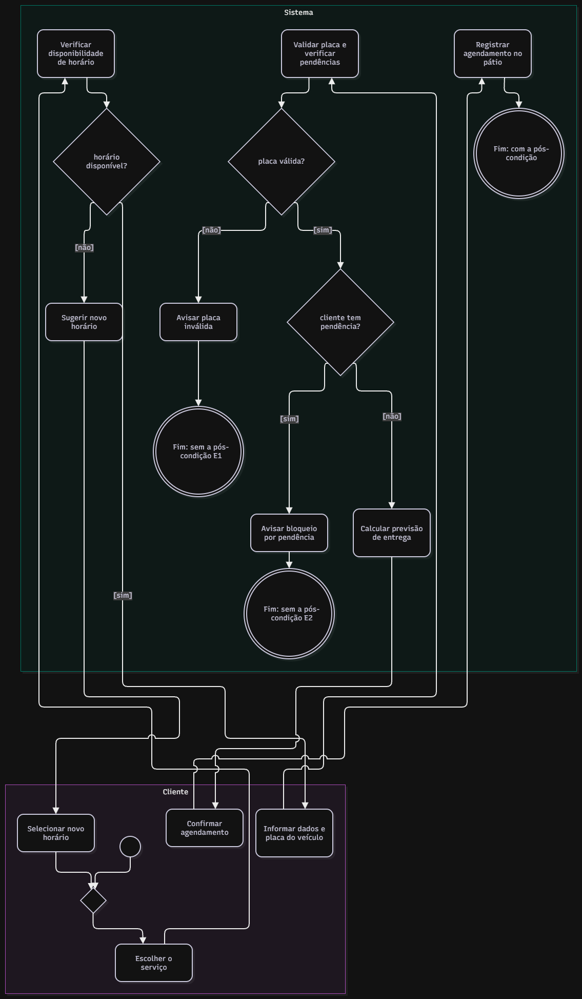

# 4.2.5 Modelagem de Atividade

## Do fluxo ao diagrama

O diagrama de atividades é o fluxo principal da seção 4.2.2 traduzido para uma visão visual de execução. A fonte única é a especificação do caso de uso **Agendar serviço**: o fluxo principal, os fluxos alternativos e as exceções mapeadas. Nenhum elemento entra no desenho sem origem documentada.

| No fluxo da 4.2.2 | Vira | Raia | Por quê |
|---|---|---|---|
| passo 1: o cliente escolhe o serviço desejado | ação **Escolher o serviço** | Cliente | quem inicia a interação e seleciona o tipo de lavagem é o ator |
| passo 2: o sistema verifica a disponibilidade de horário | ação **Verificar disponibilidade de horário** e decisão *horário disponível?* | Sistema | toda verificação do sistema gera uma pergunta (decisão) no fluxo |
| A1: horário indisponível, o sistema sugere outro e o cliente escolhe | saída `[não]` da decisão, ação **Sugerir novo horário** (Sistema), ação **Selecionar novo horário** (Cliente) e **junção** antes de verificar novamente | Sistema / Cliente | desvio alternativo que retorna ao fluxo principal por uma junção |
| passo 3: o cliente informa os dados pessoais e a placa do automóvel | ação **Informar dados e placa do veículo** | Cliente | ação do ator fornecendo os dados para validação |
| passo 4: o sistema valida a placa e verifica se há pendências no cadastro | ação **Validar placa e verificar pendências**, e **duas decisões**: *placa válida?* e *cliente tem pendência?* | Sistema | uma etapa com duas conferências desdobra-se em duas decisões sequenciais |
| E1: placa inválida, o sistema avisa e não prossegue | saída `[não]` da primeira decisão, ação **Avisar placa inválida** e um **fim** próprio | Sistema | exceção encerra o caso de uso sem atingir a pós-condição |
| E2: cliente possui pendência (falta sem aviso), o sistema bloqueia e avisa | saída `[sim]` da segunda decisão, ação **Avisar bloqueio por pendência** e um **fim** próprio | Sistema | segunda exceção; termina sem registrar o agendamento |
| passo 5: o sistema calcula a previsão de entrega (RF06) | ação **Calcular previsão de entrega** | Sistema | corresponde diretamente à operação `calcularEntrega()` da classe `Agendamento` |
| passo 6: o cliente confirma o agendamento | ação **Confirmar agendamento** | Cliente | validação final do ator antes da gravação |
| passo 7: o sistema registra o agendamento e reserva a vaga no pátio | ação **Registrar agendamento no pátio** e o **fim** do caminho feliz | Sistema | único encerramento que entrega a pós-condição do sistema |

---

## Diagrama de atividades

**Figura 4 – Diagrama de atividades de Agendar serviço**

Fonte: Autoria própria (2026).

A Figura 4 ilustra o comportamento dinâmico do caso de uso **Agendar serviço** dividido em duas raias verticais: à esquerda, as ações executadas pelo **Cliente**; à direita, o processamento e as validações do **Sistema**. As transições cruzam a fronteira entre as raias sempre que o controle da interação muda de lado.

O fluxo inicia no círculo preenchido no topo da raia do Cliente. O losango vazio logo abaixo atua como **junção**, recebendo tanto o início normal quanto o retorno do fluxo alternativo (`A1`) caso o horário inicial esteja ocupado. Ao longo do processo, três **decisões** (losangos com perguntas e saídas `[sim]` e `[não]`) controlam as regras de negócio do lava-rápido.

O diagrama possui **três fins distintos**:
* O alvo inferior na raia do Sistema representa o **sucesso (pós-condição atingida)**, onde o agendamento é gravado no banco e a vaga do pátio é reservada.
* Os dois alvos laterais representam encerramentos por **exceção (`E1` e `E2`)**, onde o processo é interrompido por placa inválida ou pendência do cliente, garantindo que nenhum agendamento irregular entre na agenda.

---

## Rastreabilidade com a 4.2.2

| Elemento do diagrama | Vem de | Confere |
|---|---|---|
| Escolher o serviço, Informar dados e placa do veículo, Confirmar agendamento | passos 1, 3 e 6 (Cliente) | três ações posicionadas na raia do ator |
| Verificar disponibilidade, Validar placa e verificar pendências, Calcular previsão de entrega, Registrar agendamento no pátio | passos 2, 4, 5 e 7 (Sistema) | quatro ações na raia do sistema, alinhadas às operações `validarPlaca()`, `temPendencia()` e `calcularEntrega()` da 4.2.3 |
| horário disponível? `[não]` | A1 (no passo 2) | retorna ao fluxo via junção após nova escolha do cliente |
| placa válida? `[não]` | E1 (no passo 4) | encerra em fim próprio sem a pós-condição |
| cliente tem pendência? `[sim]` | E2 (no passo 4) | encerra em fim próprio sem a pós-condição |
| fim com a pós-condição | pós-condição da 4.2.2 | alcançado exclusivamente pelo caminho principal |

**Todo passo tem elemento.** Todos os sete passos do fluxo principal, o desvio alternativo e as duas exceções estão representados sem elementos inventados fora da especificação.

**O que o desenho mudou.** O passo 4 da 4.2.2 agrupava a validação da placa do veículo e a checagem de pendências do cliente na mesma frase. Ao desenhar as decisões, ficou evidente que são duas verificações de classes distintas (`Veiculo.validarPlaca()` e `Cliente.temPendencia()`), gerando uma nota `❓` para desmembrar esse passo na revisão final da 4.2.2.
